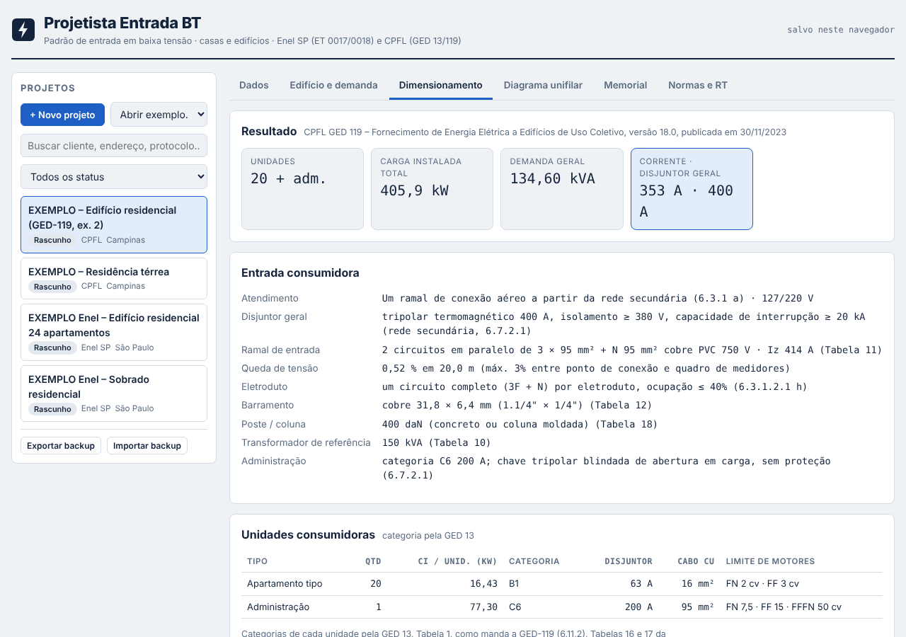

# ⚡ Projetista Entrada BT

Aplicação web para **dimensionar o padrão de entrada de energia elétrica em baixa tensão** de casas e edifícios no estado de São Paulo, conforme as normas da **Enel SP** e da **CPFL**.

Lança-se o quadro de cargas e o app calcula a demanda, enquadra a categoria/tipo de fornecimento e indica disjuntor, condutores, eletroduto, aterramento, poste e DPS. Também gera o **diagrama unifilar** (SVG) e o **memorial descritivo** (Word/HTML).



## Funcionalidades

- **Conexão individual** (casa, loja): demanda pelo método da GED 13 (item 6.22.1, parcelas a–i) e enquadramento na Tabela 1 da CPFL ou no Anexo B da ET 0017 da Enel.
- **Edifício de uso coletivo**: demanda geral pela GED-119 (item 6.11: D1, D2, D3 e coeficiente de simultaneidade), ramal de entrada, disjuntor geral, barramento, poste e transformador de referência. Para Enel, conexão e entrada pela ET 0018.
- Verificação de **queda de tensão** com aumento automático da seção quando necessário.
- **Diagrama unifilar** gerado a partir do dimensionamento (download em SVG).
- **Memorial descritivo** com dados do responsável técnico e ART/TRT (download .doc ou .html).
- Controle de **andamento na concessionária** (rascunho → protocolado → aprovado → ligado).
- **Backup** em JSON (exportar/importar).
- Projeto novo só é gravado ao clicar em **Salvar projeto**; depois disso, as alterações são gravadas automaticamente.
- Botão **Excluir** em cada projeto da lista, com confirmação.
- Cinco projetos de exemplo: casa, edifício residencial e edifício comercial (Enel SP); casa e edifício (CPFL).

## Normas utilizadas

| Distribuidora | Documento | Versão |
|---|---|---|
| CPFL | GED 13 – Fornecimento em Tensão Secundária de Distribuição | 46.0 (19/03/2026) |
| CPFL | GED 119 – Fornecimento a Edifícios de Uso Coletivo | 18.0 (30/11/2023) |
| Enel SP | ET 0017 – Conexão Individual até 1 kV | 02 (06/03/2025) |
| Enel SP | ET 0018 – Conexão Coletiva até 1 kV | 2 (08/09/2025) |

Complementares: ABNT NBR 5410, NBR 13571, REN ANEEL nº 1.000/2021 e NR-10.

**Limitações conhecidas:** Enel SP só na rede aérea 127/220 V estrela (as redes delta 120/240 V e subterrânea não estão cobertas); entrada subterrânea individual usa a tabela da rede aérea. Como a ET 0017/0018 deixa o método de demanda ao responsável técnico, o app usa o método publicado da CPFL também para a Enel.

## Como usar

É um site estático, sem build e sem dependências.

```bash
git clone https://github.com/<seu-usuario>/projetista-entrada-bt.git
cd projetista-entrada-bt
# abra index.html no navegador, ou sirva localmente:
python3 -m http.server 8000   # http://localhost:8000
```

### Publicar no GitHub Pages

O workflow em `.github/workflows/pages.yml` publica a cada push na `main`. No repositório, vá em **Settings → Pages → Source: GitHub Actions**.

## Armazenamento dos dados

Fora do claude.ai, os projetos ficam no `localStorage` do navegador (chave `entradaBT.v1`): não saem do computador, mas somem se o cache for limpo. Use **Exportar backup** com frequência. Quando aberto como artefato no claude.ai, o app usa o armazenamento da conta do usuário.

## Estrutura

```
├── entrada-bt.html     # FONTE do app em arquivo único (é o que se edita e o que vai para o claude.ai)
├── tools/build.py      # gera index.html e assets/ a partir de entrada-bt.html
├── index.html          # estrutura da página (gerado)
├── assets/
│   ├── style.css       # tema claro/escuro e layout
│   └── app.js          # tabelas das normas, cálculos, telas e persistência
├── docs/screenshot.png
└── .github/workflows/pages.yml
```

### Como alterar o app

Edite `entrada-bt.html` e depois rode `python tools/build.py` para atualizar `index.html`, `assets/style.css` e `assets/app.js`. Não edite os arquivos gerados direto: a próxima execução do script sobrescreve.

Em `assets/app.js`, as tabelas das normas ficam no topo (`CPFL`, `ENEL`, `T3`–`T11`, `G119_*`, `ET0018_*`). As funções de cálculo principais são `calc()` (individual), `calcColetivo()` e `calcColetivoEnel()` (edifícios).

## Aviso

Ferramenta de apoio ao projeto. Os resultados **não substituem** a análise do responsável técnico nem a consulta às versões vigentes das normas da distribuidora. Confira sempre os valores antes de protocolar.

## Licença

[MIT](LICENSE)
